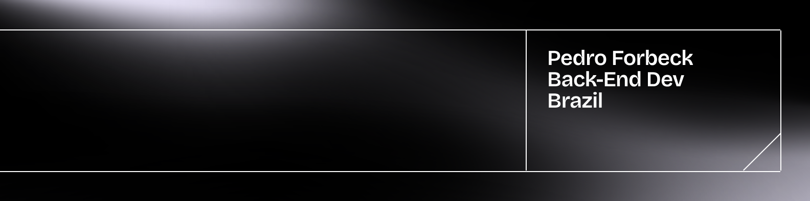

  

---

### > About Me

I'm a **Software Engineering** student focused on backend development with Java and Spring Boot. My projects explore REST APIs, authentication, microservices, event-driven systems, and observability.

I've contributed accepted changes to open-source projects, including toxibr and Facepunch's s&box. I'm currently looking for a backend internship or junior developer opportunity.

* `[work]` Building robust backends with **Spring Boot** and **Spring Security**.
* `[goal]` Focused on clean code, secure API design, and scalable architectures.
---

###  Skills & Tools

  
  
  
  
  
  
  
  
  

---

<h3 align="center">Connect with me</h3>

  &nbsp;&nbsp;&nbsp;&nbsp;
  

